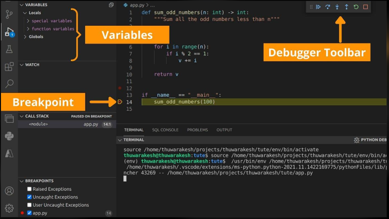
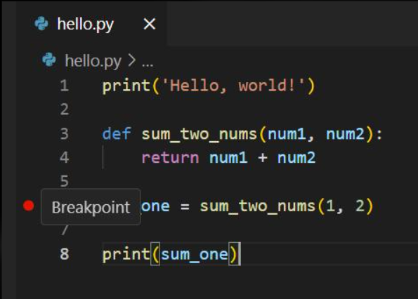
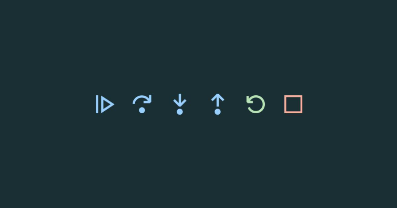

# **O que é debugging?**

*Debugging* é o processo de investigar um programa para encontrar e corrigir problemas.

Imagine que você escreveu um código para calcular a média de três notas, mas o resultado está incorreto.

O debugging permite investigar:

- Onde está o problema?
- Qual variável está com valor incorreto?
- Em qual momento o resultado deixou de ser o esperado?
- Como corrigir o código?

# **2. Os três principais tipos de erros**

Em Python, podemos encontrar três categorias importantes.

### **2.1 Erros de sintaxe (SyntaxError)**

Acontecem quando escrevemos o código desrespeitando as regras da linguagem.

**Exemplo:**

```
if idade >= 18    
    print("Maior de idade")
```

O problema é que faltou `:` depois da condição do `if`.

Mensagem semelhante à apresentada pelo Python:

```
SyntaxError: expected ':'
```

O programa não consegue executar corretamente porque existe um problema na estrutura do código.

### **2.2 Erros de execução (Runtime Errors)**

Acontecem enquanto o programa está sendo executado.

**Exemplo:**

```
numero1 = 10
numero2 = 0

resultado = numero1 / numero2
```

O código possui uma sintaxe válida, mas tenta dividir por zero.

Mensagem:

```
ZeroDivisionError: division by zero
```

Outros exemplos:

- `ValueError`
- `TypeError`
- `IndexError`
- `KeyError`
- `FileNotFoundError`

Esses são alguns dos erros que estudamos no assunto anterior.

### **2.3 Erros de lógica (Logical Errors)**

Acontecem quando o código executa normalmente, mas produz um resultado incorreto.

**Exemplo:**

```
nota1 = 8
nota2 = 6
nota3 = 10

media = nota1 + nota2 + nota3 / 3

print(media)
```

O resultado será `17.33`, mas a média correta é `8.0`.

O problema está na ausência dos parênteses. O Python realiza a divisão antes das somas.

Correção:

```
media = (nota1 + nota2 + nota3) / 3
```

**Comparação dos três tipos de erros**

Sintaxe

O código foi escrito incorretamente e não consegue ser interpretado.

Execução

O código começa a executar, mas acontece uma exceção.

Lógica

O código executa, mas o resultado não é o esperado.

# **3. Como interpretar mensagens de erro (Tracebacks)**

Quando acontece uma exceção não tratada, o Python apresenta um relatório chamado *traceback*.

Ele mostra o caminho percorrido pelo programa até encontrar o erro.

**Exemplo:**

```
numeros = [10, 20, 30]

print(numeros[5])
```

Mensagem de erro:

```
Traceback (most recent call last):
  File "programa.py", line 3, in <module>
    print(numeros[5])
IndexError: list index out of range
```

Vamos entender cada parte:

| Trecho                    | Significado                       |
| ------------------------- | --------------------------------- |
| `Traceback`               | Início do relatório de erro       |
| `File "programa.py"`      | Arquivo em que ocorreu o problema |
| `line 3`                  | Número da linha problemática      |
| `print(numeros[5])`       | Instrução que provocou o erro     |
| `IndexError`              | Tipo de exceção                   |
| `list index out of range` | Explicação do problema            |

**Dica importante:** normalmente, a última linha do traceback apresenta o tipo de erro e uma descrição do que aconteceu.

Quando houver várias chamadas de funções, o traceback também mostra a sequência de chamadas que levou ao problema.

# **4. Utilizando print() para investigar problemas**

Uma maneira simples de encontrar erros de lógica é utilizar `print()` para verificar os valores das variáveis durante a execução.

Imagine o seguinte código:

```
preco = 100
desconto = 20

valor_final = preco - desconto / 100

print(valor_final)
```

O resultado está incorreto porque a fórmula foi escrita de maneira errada.

Podemos investigar os valores:

```
preco = 100
desconto = 20

print("Preço:", preco)
print("Desconto:", desconto)

valor_final = preco - desconto / 100

print("Valor final:", valor_final)
```

Assim conseguimos acompanhar os valores utilizados pelo programa e identificar onde está o problema.

O `print()` é especialmente útil para:

- Conferir valores de variáveis.
- Verificar resultados intermediários.
- Acompanhar a execução de loops.
- Descobrir em qual etapa o resultado ficou incorreto.

# **5. Depurador do VS Code (Debugger)**

O VS Code possui uma ferramenta chamada *Debugger*, que permite executar o código passo a passo e acompanhar o comportamento do programa.



Uma das principais funcionalidades é o **Breakpoint**.

### **5.1 Breakpoint**

É um ponto de parada que colocamos em determinada linha do código.

Quando a execução chega nessa linha, o programa pausa e permite investigar:

- O valor das variáveis.
- O resultado de operações.
- Qual será a próxima instrução executada.

No VS Code, basta clicar ao lado esquerdo do número da linha para adicionar um breakpoint.



### **5.2 Step Over**

Executa a próxima linha sem entrar no interior de uma função chamada.

Atalho comum: `F10`.

### **5.3 Step Into**

Entra dentro de uma função chamada para acompanhar sua execução linha por linha.

Atalho comum: `F11`.

### **5.4 Step Out**

Termina a execução da função atual e retorna ao ponto em que ela foi chamada.

Atalho comum: `Shift + F11`.

### **5.5 Continue**

Continua a execução normalmente até encontrar outro breakpoint ou o programa terminar.

Atalho comum: `F5`.



# **6. Exemplo prático de debugging**

Imagine este programa:

```
def calcular_media(notas):    
    soma = sum(notas)    
    media = soma / 2    
    
    return media
    
notas = [8, 7, 9]

resultado = calcular_media(notas)

print(resultado)
```

O programa executa, mas a média está incorreta.

Vamos investigar:

1. A lista contém três notas.
2. A soma é `24`.
3. O código divide a soma por `2`.
4. O correto seria dividir por `3`.

O erro estava na lógica da função.

Correção:

```
def calcular_media(notas):    
    soma = sum(notas)    
    media = soma / len(notas)    
    
    return media
    
notas = [8, 7, 9]

resultado = calcular_media(notas)

print(resultado)
```

Resultado correto: `8.0`.

# **Resumo do assunto**

| Conceito      | O que faz                                      |
| ------------- | ---------------------------------------------- |
| Debugging     | Processo de encontrar e corrigir erros         |
| SyntaxError   | Erro na escrita do código                      |
| Runtime Error | Erro durante a execução                        |
| Logical Error | Resultado incorreto                            |
| Traceback     | Relatório que mostra o caminho até uma exceção |
| `print()`     | Ajuda a investigar valores e execução          |
| Breakpoint    | Pausa o programa em uma linha                  |
| Step Over     | Executa a próxima linha sem entrar na função   |
| Step Into     | Entra na função chamada                        |
| Step Out      | Sai da função atual                            |
| Continue      | Continua a execução                            |
